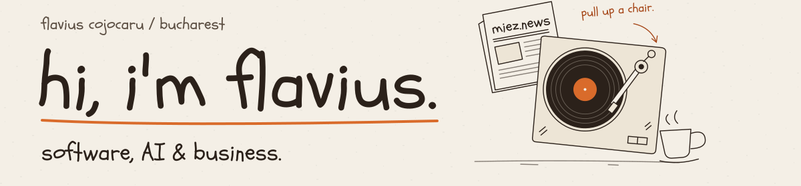
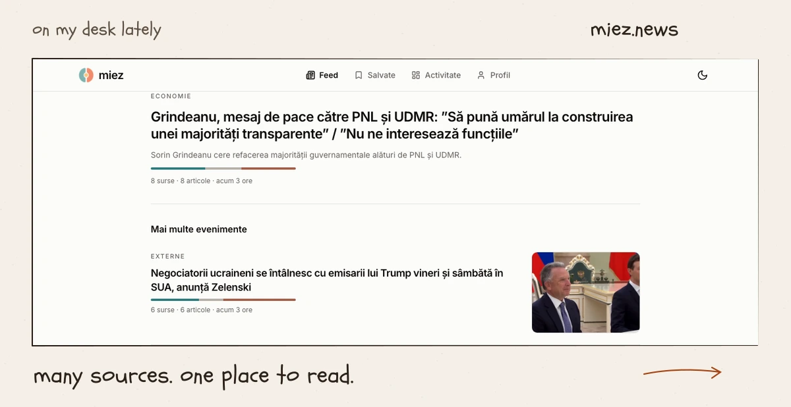
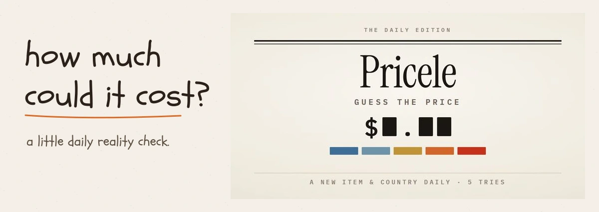
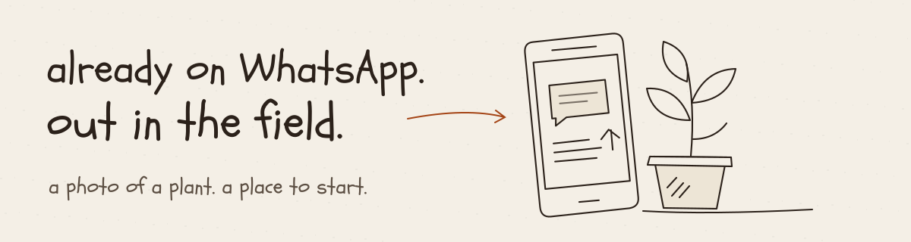
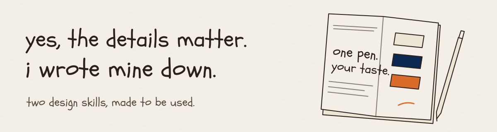

Software engineer in Bucharest. Into AI, business, and building useful products.

[website](https://flavius.pro) · [email](mailto:flaviuscojocaru19@gmail.com) · [linkedin](https://www.linkedin.com/in/flavius-cojocaru-20834a246/) · [X](https://x.com/flaviuscj7)

### on my desk

- [miez.news](https://miez.news) · Romanian news, condensed. [code](https://github.com/flvvius/news)
- [Pricele](https://pricele.online) · One country, one item, five guesses. [code](https://github.com/flvvius/pricele)
- [Agro-Bot](https://github.com/flvvius/Agro-Bot) · Crop advice on WhatsApp.
- [design taste](https://github.com/flvvius/flavius-design-taste) · My visual preferences as agent skills.
- [commit.ink](https://github.com/flvvius/commit-social) · First place at the Adobe Hackathon 2025.

peek inside · project previews

### [miez.news](https://miez.news)

My biggest ongoing project. Web and mobile share one codebase, mostly in TypeScript.

[read the news](https://miez.news) · [the code](https://github.com/flvvius/news)

### [Pricele](https://pricele.online)

A daily game about what things cost around the world.

[play today's game](https://pricele.online) · [the code](https://github.com/flvvius/pricele)

### [Agro-Bot](https://github.com/flvvius/Agro-Bot)

Plant diagnosis from a photo, crop weather, and cereal prices for Romanian farmers.

[the code](https://github.com/flvvius/Agro-Bot)

### [Flavius design taste](https://github.com/flvvius/flavius-design-taste)

Quiet interfaces for everyday work; handwriting and meaningful objects for personal spaces. This profile uses the second one.

[use the skills](https://github.com/flvvius/flavius-design-taste)

